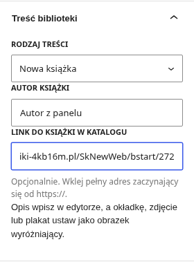

# Wgraj gotowy wygląd do swojego WordPressa

Gotowy motyw to **`biblioteka-ranizow-wordpress.zip`** w folderze `do-pobrania` repozytorium. Paczka HTML `biblioteka-na-hosting.zip` pozostaje dawną makietą i nie służy do instalacji motywu.

## Gdy wpisy widać po zalogowaniu, ale nie w inkognito — W3 Total Cache

Raport z instalacji wskazał aktywny W3 Total Cache oraz poprawnie opublikowane i pobierane wpisy. Ta wtyczka ma osobną opcję automatycznego czyszczenia statycznej strony głównej; domyślnie jest ona wyłączona. Włącz ją i usuń starą kopię:

1. Zaloguj się jako administrator.
2. Otwórz [Performance → Page Cache → Purge Policy](https://bibliotekaranizow.ct.ws/wp-admin/admin.php?page=w3tc_pgcache#purge_policy).
3. Znajdź sekcję **Purge Policy: Page Cache**. Możesz użyć **Ctrl + F** i wyszukać **Front page**.
4. Zaznacz **Front page**, czyli statyczną stronę główną.
5. Kliknij **Save all settings**.
6. Na górnym pasku najedź na **Performance** i kliknij **Purge All Caches**.
7. W oknie inkognito otwórz zwykły adres **https://bibliotekaranizow.ct.ws/**, bez linku podglądu administratora. Sprawdź aktualności i kalendarz.

W motywie 1.0.2 jest również jawne wywołanie publicznego API W3TC dla strony głównej po pełnym zapisaniu publicznego wpisu, także jego pól przez REST. Działa ono niezależnie od opcji Front page i nie zmienia ustawień wtyczki. Włączenie tej opcji jest nadal zalecane dla pozostałych zmian strony. Bez W3TC motyw korzysta ze standardowego odświeżania WordPressa.

## Aktualizacja już zainstalowanego motywu do 1.0.2

1. Pobierz ponownie [ZIP motywu](https://github.com/pkksa213/biblioteka/raw/refs/heads/main/do-pobrania/biblioteka-ranizow-wordpress.zip). Zachowaj plik ZIP bez rozpakowywania.
2. Zaloguj się jako administrator i otwórz [wysyłanie motywu](https://bibliotekaranizow.ct.ws/wp-admin/theme-install.php?upload).
3. Kliknij **Wybierz plik**, wskaż nowy ZIP i kliknij **Zainstaluj**.
4. Gdy WordPress wykryje istniejący motyw, kliknij **Zastąp obecny motyw przesłanym**. Nowa wersja to **1.0.2**.
5. Nie trzeba ponownie przygotowywać stron ani dodawać wpisów. Aktualizacja podmienia pliki motywu; treści pozostają w bazie.
6. Otwórz [Wygląd → Sprawdź wpisy](https://bibliotekaranizow.ct.ws/wp-admin/themes.php?page=br-posts).
7. Kliknij **Otwórz świeży podgląd strony głównej**. Na górze zobaczysz wersję motywu i godzinę wygenerowania podglądu.
8. Jeśli nadal brakuje wpisu, skopiuj raport z tego ekranu do rozmowy. Raport pokazuje aktualne ID wpisów pobieranych do sekcji, zapisany rodzaj, status, terminy wydarzeń, przypisanie stron i aktywne wtyczki. Nie zawiera haseł ani danych logowania.

Poprawka kalendarza z 1.0.1 obejmuje wydarzenia, których termin rozpoczęcia jest zapisany, lecz opcjonalne zakończenie w bazie nie istnieje, jest puste lub ma wartość zero. Takie wydarzenie pozostaje widoczne do końca dnia rozpoczęcia. Minione wydarzenia i wpisy bez początku pozostają poza kalendarzem. Integracja cache obejmuje standardowy mechanizm WordPressa i publiczne API W3 Total Cache. Nie gwarantuje wyczyszczenia dowolnego dodatkowego cache poza nimi.

Bezpośredni odczyt domeny nadal jest blokowany przez sieć środowiska. Diagnoza instalacji opiera się na raporcie użytkownika: wersja 1.0.1, W3TC, publiczne wpisy zwracane przez właściwe zapytania oraz różnica między świeżym podglądem a zwykłą stroną w inkognito. Przed poprawką odtworzono brak sygnału czyszczenia statycznej strony głównej z prawdziwym API W3TC i jego domyślną polityką. Nie sprawdzono jeszcze wyniku aktualizacji na zewnętrznym hostingu.

## 1. Pobierz właściwy plik

Otwórz [ZIP motywu na GitHubie](https://github.com/pkksa213/biblioteka/blob/main/do-pobrania/biblioteka-ranizow-wordpress.zip) i kliknij strzałkę **Download raw file**. Nie rozpakowuj pliku przed wysłaniem go do panelu WordPressa.

## 2. Zainstaluj i włącz motyw

1. Zaloguj się na konto administratora swojego WordPressa.
2. Otwórz **[formularz wysyłania motywu](https://bibliotekaranizow.ct.ws/wp-admin/theme-install.php?upload)**. Przez menu: **Wygląd → Motywy → Dodaj nowy → Wyślij motyw na serwer**.
3. Kliknij **Wybierz plik** i wskaż **biblioteka-ranizow-wordpress.zip**.
4. Kliknij **Zainstaluj** i poczekaj na zakończenie.
5. Kliknij **Włącz / Aktywuj** przy motywie **Biblioteka Raniżów**.

To zmienia motyw w istniejącej instalacji. Nie trzeba instalować WordPressa drugi raz, kopiować jego plików ani usuwać obecnej bazy. Zachowaj wykonaną wcześniej kopię strony.

## 3. Przygotuj strony i menu jednym przyciskiem

1. Po aktywacji kliknij komunikat o przygotowaniu strony. Możesz też otworzyć **[Uruchom bibliotekę](https://bibliotekaranizow.ct.ws/wp-admin/themes.php?page=br-start)** lub **Wygląd → Uruchom bibliotekę**.
2. Przeczytaj opis i kliknij **Przygotuj stronę biblioteki**.
3. Poczekaj na komunikat **Strona przygotowana**.
4. Kliknij **Zobacz bibliotekę**.

Przygotowanie wykorzystuje istniejące strony i kategorie, ustawia stronę główną i listę wpisów oraz tworzy brakujące elementy menu. Puste strony informacyjne otrzymują odpowiedni wygląd i zostają opublikowane. Istniejące treści zostają zachowane. Dokumenty prawne pozostają szkicami; motyw nie tworzy przykładowych książek ani ogłoszeń.

Jeżeli wcześniej samodzielnie wypełniłeś stronę „Dla czytelników”, jej treść zostaje zachowana. Nowy układ możesz wybrać w ustawieniach tej strony: **Szablon → Strefa czytelnika**. Treść będzie widoczna również pod przygotowanymi blokami.

## 4. Sprawdź dane kontaktowe i godziny

1. Otwórz **[Dane biblioteki](https://bibliotekaranizow.ct.ws/wp-admin/admin.php?page=br-library)**.
2. Sprawdź bibliotekę główną, obie filie, telefony i katalogi.
3. Popraw dane, które się zmieniły. Pusty dzień oznacza brak informacji — wpisz „Nieczynne” tylko po potwierdzeniu.
4. Kliknij na dole **Zapisz dane biblioteki**.

Zmiana jest wspólna dla strony głównej, kontaktu, filii i stopki. Dostęp do tego formularza ma także Redaktor. Osobny katalog Woli Raniżowskiej jest opcjonalny; bez niego motyw prowadzi jawnie do katalogu całej gminy.

## 5. Dodaj artykuł, książkę, wydarzenie lub ogłoszenie

1. Otwórz **[Dodaj wpis](https://bibliotekaranizow.ct.ws/wp-admin/post-new.php)**.
2. Wpisz tytuł i treść w edytorze.
3. Po prawej wybierz zakładkę **Wpis**, następnie rozwiń **Treść biblioteki**. Jeśli prawa kolumna jest schowana, otwórz ustawienia edytora przyciskiem w prawym górnym rogu.
4. Z listy **Rodzaj treści** wybierz właściwy typ.
5. Uzupełnij dodatkowe pola i ustaw zdjęcie wyróżniające, jeśli jest potrzebne.
6. Sprawdź podgląd i kliknij **Opublikuj**. Szkice nie są widoczne dla odwiedzających.

| Rodzaj treści | Co uzupełnić | Gdzie pojawi się po publikacji |
| --- | --- | --- |
| Artykuł | Tytuł, tekst, kategoria, opcjonalne zdjęcie | Aktualności i lista wpisów |
| Nowa książka | Autor, opcjonalny link do pozycji w katalogu; okładka jako zdjęcie wyróżniające | Sekcja nowości książkowych i własna strona wpisu |
| Wydarzenie | Data i godzina rozpoczęcia, miejsce, opcjonalny koniec; opis i plakat | Kalendarz na stronie głównej do zakończenia oraz archiwum wpisów |
| Ważne ogłoszenie | Tytuł, opis i opcjonalnie termin wygaśnięcia | Żółty blok ważnych ogłoszeń i archiwum wpisów |

Bez godziny końca wydarzenie pozostaje w kalendarzu do końca danego dnia. Puste pole wygaśnięcia ogłoszenia oznacza brak terminu wycofania z żółtego bloku. Minione wydarzenia i wygasłe ogłoszenia pozostają w archiwum, ale nie w aktywnych blokach. Zaplanowane wpisy czekają na publikację zgodnie z mechanizmem WordPressa; poprawność działania harmonogramu trzeba sprawdzić na hostingu.

Wybierz kategorię „Dla dzieci i młodzieży” przy książce dla dzieci. Książka bez wybranej grupy trafi domyślnie do nowości dla dorosłych. Wydarzenia i ważne ogłoszenia dostają odpowiednie kategorie automatycznie.

## 6. Dodaj zdjęcia do galerii

1. Otwórz **Strony → Wszystkie strony**.
2. Znajdź **Galeria** i kliknij **Edytuj**.
3. Kliknij **+**, wyszukaj blok **Galeria** i wstaw go.
4. Wgraj własne zdjęcia, uzupełnij teksty alternatywne i ewentualne podpisy.
5. Kliknij **Aktualizuj**.

Pierwsze sześć zdjęć z natywnego bloku galerii pojawi się także na stronie głównej. Bez zdjęć sekcja na stronie głównej jest ukryta. Do publikacji zdjęć potrzebne są odpowiednie prawa i podstawa udostępniania wizerunku.

## 7. Uzupełnij dokumenty

W **Strony** znajdziesz szkice regulaminu, statutu, ochrony małoletnich, deklaracji dostępności i prywatności. Uzupełnij je rzeczywistymi dokumentami oraz wynikami oceny strony, uzgodnij z biblioteką/IOD i dopiero wtedy opublikuj. Po publikacji odnośniki pojawią się w strefie dokumentów i stopce. Do tego czasu odwiedzający widzą informację o przygotowaniu dokumentów oraz kontakt.

Motyw nie zapewnia automatycznej zgodności WCAG i nie zatwierdza prawnie dokumentów. W tej sesji nie uzyskano odczytu urzędowych źródeł z powodu blokady proxy. Dane kontaktowe pochodzą z informacji użytkownika i wymagają sprawdzenia aktualności przed publicznym uruchomieniem instytucji.

## Co przejmuje WordPress

Nie trzeba już wgrywać całej paczki przy każdym artykule. Redakcja wpisuje treści w panelu, a motyw pokazuje ostatnie opublikowane artykuły, książki, aktywne ogłoszenia i nadchodzące wydarzenia. Katalog zbiorów pozostaje odrębnym serwisem. Automatyczne importowanie książek nie zostało dodane.
